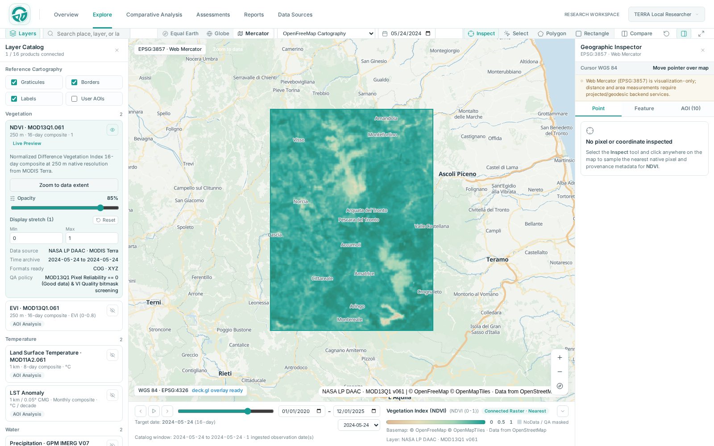
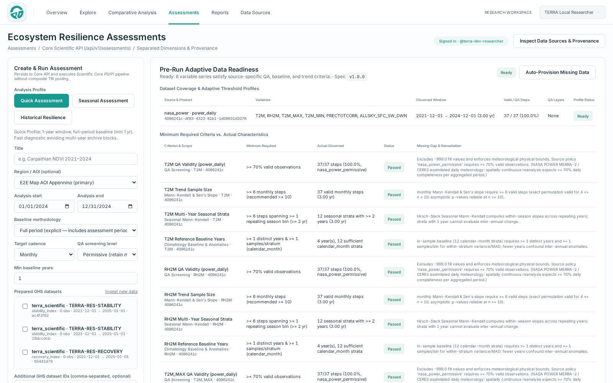
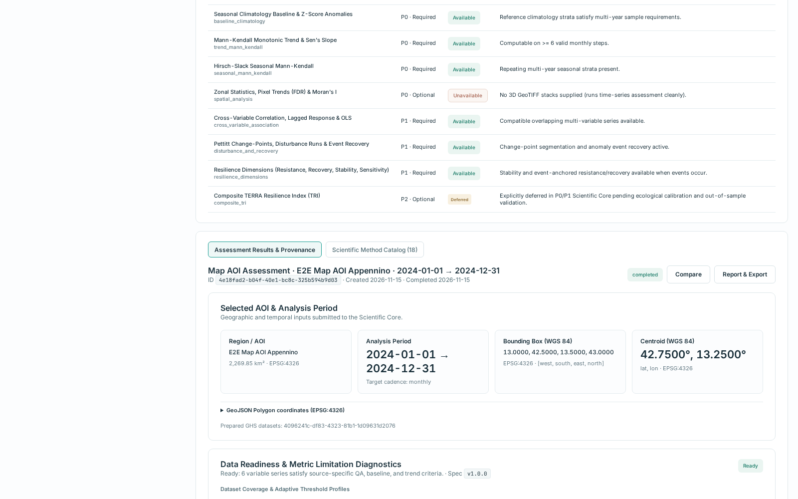
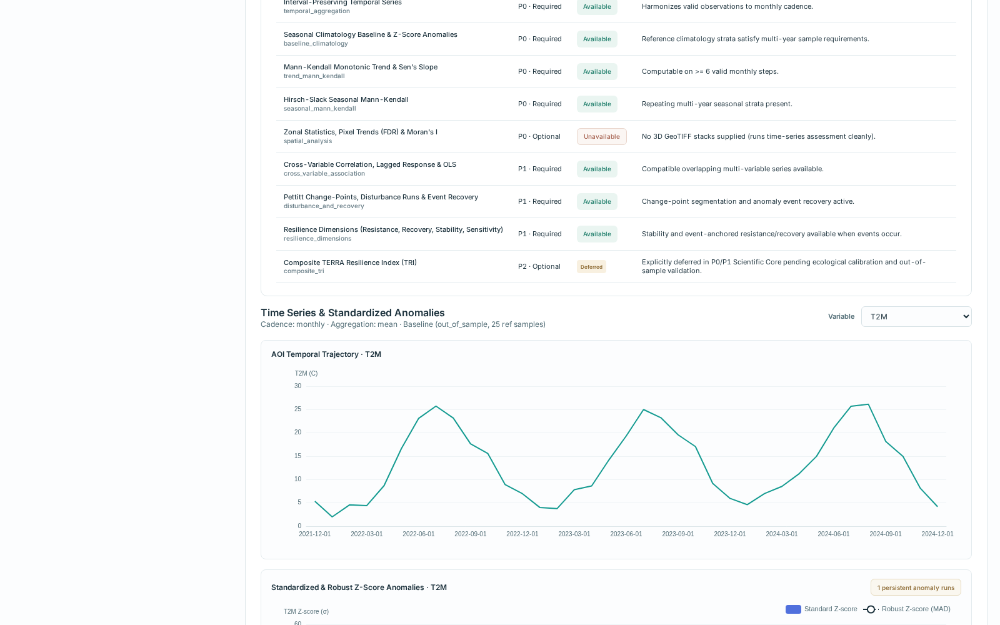
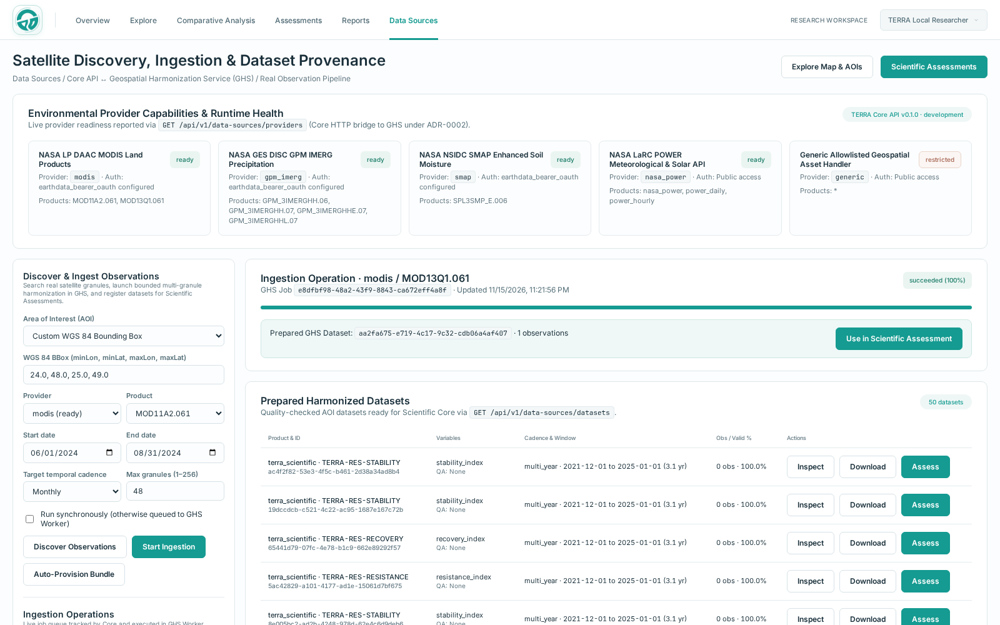
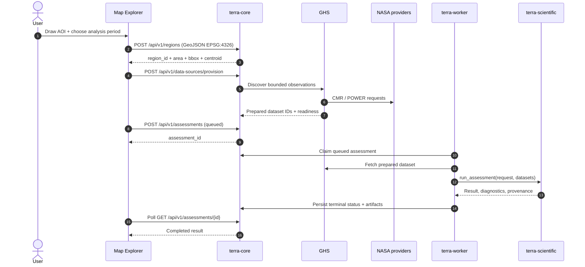
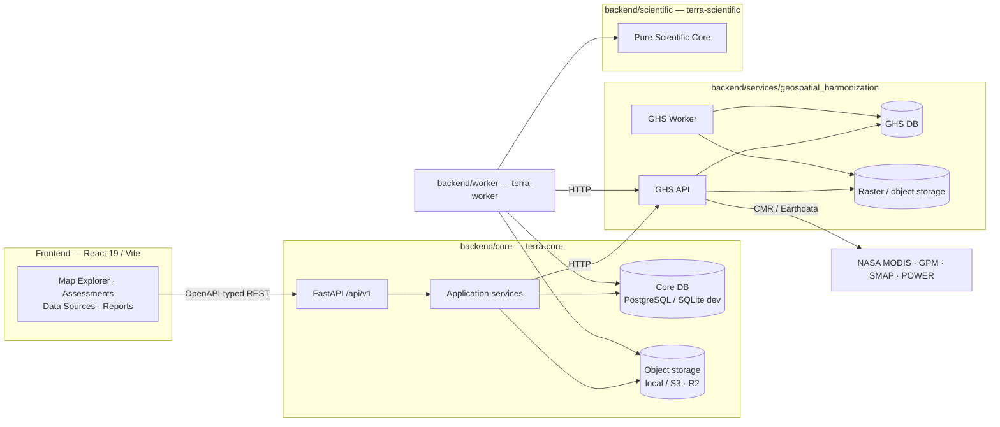

<div align="center">

# PROJECT TERRA

**Ecosystem Response & Resilience Intelligence**

Turn Earth observation into transparent, reproducible ecosystem assessments.

[](LICENSE)
[](backend/core/pyproject.toml)
[](frontend/package.json)
[](backend/core)
[](docs/scientific/SCIENTIFIC_CORE.md)
[](#project-status)

[Overview](#overview) · [Screenshots](#screenshots) · [Architecture](#architecture) · [Scientific Core](#scientific-core) · [Quick Start](#quick-start) · [Docker](#docker-compose) · [Documentation](#documentation)

</div>

---



## Overview

**PROJECT TERRA** is an open-source environmental analysis platform for investigating how ecosystems respond to environmental stress, change over time, and recover from disturbances.

The platform connects a geographic **Area of Interest (AOI)** to **real NASA observations**, runs the existing **Scientific Core**, and returns an assessment with trends, anomalies, resilience dimensions, quality diagnostics, and provenance. It is designed to keep three things separate and visible:

- **Observations** — real provider data with units, timestamps, QA layers, and product identifiers.
- **Scientific analysis** — deterministic, versioned algorithms with explicit assumptions and readiness requirements.
- **Visualization** — map previews and charts that never become the source of a quantitative result.

> PROJECT TERRA was initiated in the context of the NASA Space Apps Challenge 2026. It is an independent open-source project and is not an official NASA product.

---

## Screenshots

| Map Explorer — live metric preview | Assessments — readiness diagnostics |
| :---: | :---: |
|  |  |

| Assessment outputs — AOI, period, provenance | Scientific charts — time series and anomalies |
| :---: | :---: |
|  |  |

| Data Sources — provider readiness and ingestion |
| :--- |
|  |

---

## Browser-native live environment (MVP)

The primary map workflow does **not** require Core, GHS, PostgreSQL, R2, or a background worker. The browser talks directly to public providers and computes supported statistics locally in a Web Worker.

| Capability | Direct source | How it works |
| :--- | :--- | :--- |
| Global NDVI / EVI visualization | NASA GIBS WMTS | `MODIS_Terra_L3_NDVI_16Day`, `MODIS_Terra_L3_EVI_16Day` tiles are loaded directly by MapLibre. |
| Land surface temperature | NASA GIBS WMTS | Day and night `MODIS_Terra_Land_Surface_Temp_*` layers with date-aware tiles. |
| Precipitation | NASA GIBS WMTS | `IMERG_Precipitation_Rate` global visualization. |
| Soil moisture | NASA GIBS WMTS | `SMAP_L4_Analyzed_Surface_Soil_Moisture`. |
| Snow cover | NASA GIBS WMTS | `MODIS_Terra_NDSI_Snow_Cover`. |
| MODIS NDVI numerical AOI statistics | Microsoft Planetary Computer STAC + COG | STAC search → SAS signing → `geotiff.js` HTTP Range reads of only the AOI window → scaled NDVI statistics, time series, anomalies, Mann–Kendall and Theil–Sen. |
| Point meteorology | NASA POWER API | Monthly point series for temperature, humidity, precipitation, radiation, and wind, parsed and analysed in the browser. |

**Scientific boundary:** GIBS tiles are pre-rendered visualizations. They are never used as numerical NDVI, LST, precipitation, or soil-moisture values. Numerical NDVI comes from the MOD13Q1 COG asset; point meteorology comes from NASA POWER.

**MVP limits, stated explicitly:**

- MODIS numerical series currently reads at most 12 Terra composites for the selected period and applies no QA layer yet; fill/NoData pixels remain missing.
- Planetary Computer SAS signing is rate-limited; transient `429` responses are retried, and unread composites are reported as missing.
- The geotiff reader is loaded from the `esm.sh` ESM CDN at calculation time; the map and POWER path do not depend on it.
- Standard (not seasonal) Mann–Kendall and approximate Theil–Sen confidence bounds are used client-side; p-values can be optimistic for serially correlated series.
- No raster data is uploaded to or persisted by TERRA.

```bash
# The live map and POWER/MODIS calculations work even when Core is stopped.
cd frontend && pnpm dev
# Open http://localhost:5173/explore
```

---

## What TERRA does

| Capability | What it means in practice |
| :--- | :--- |
| **AOI-driven workflow** | Draw a polygon/rectangle or select a point AOI in Map Explorer; save it as an EPSG:4326 region and carry it into an assessment. |
| **Real data acquisition** | Discover and ingest bounded NASA granules or point/regional meteorology through GHS. No global dataset downloads, no synthetic substitutions. |
| **Adaptive readiness** | Check source-specific QA, temporal coverage, baseline depth, and method requirements **before** execution. Missing gaps are reported with remediation. |
| **Scientific Core execution** | Run only implemented P0/P1 methods, with preserved units, timestamps, missing-value masks, QA flags, and method versions. |
| **Truthful results** | Terminal statuses distinguish `completed`, `completed_partial`, and `insufficient_data`. Unavailable metrics are reported as unavailable, not zero. |
| **Map metric preview** | Switch between supported environmental layers with legends, units, loading states, and explicit unavailable reasons. Preview is visualization, not assessment. |
| **Provenance everywhere** | Input hashes, product versions, source datasets, method versions, artifact manifests, and object-storage checksums. |

---

## End-to-end workflow



The map is an **AOI and preview interface**. Scientific analysis never depends on rendered raster tiles, screenshots, or NASA GIBS imagery.

---

## Architecture

TERRA is a modular monolith for Core plus two isolated execution boundaries: **GHS** for heavy geospatial ingestion (ADR-0002) and **terra-scientific** for pure, independently testable algorithms.



### Component responsibilities

| Component | Runtime | Responsibility |
| :--- | :--- | :--- |
| **Frontend** | React 19, Vite 8, MapLibre 5, deck.gl, TanStack Query, Zustand, ECharts 6 | Map/AOI interaction, metric previews, assessment configuration, readiness and result visualization, reports. |
| **terra-core** | FastAPI, Granian, SQLAlchemy async, Pydantic | Auth, regions, layers, data-source proxy, assessment orchestration, readiness, artifacts, comparison. |
| **terra-scientific** | Pure Python, NumPy, Pandas, SciPy, Pydantic | Deterministic scientific methods and contracts. No HTTP, database, storage, or UI dependencies. |
| **terra-worker** | Async queue runner | Claims queued assessments, fetches prepared GHS datasets, runs Scientific Core, persists results and artifacts. |
| **GHS** | FastAPI, Granian, rasterio/xarray/h5py/netCDF4/Zarr/Shapely | Multi-provider discovery, bounded ingestion, QA, temporal harmonization, COG publishing, tile and zonal-statistics services. |
| **PostgreSQL** | Optional production / Docker | Shared Core and GHS database engine with isolated databases and migrations. |
| **Object storage** | Local filesystem or S3-compatible | Assessment artifacts and GHS raster/object lifecycle. |

### Repository layout

```text
project-terra/
├── frontend/                       # React 19 SPA (FSD-lite: app → pages → widgets → features → entities → shared)
│   ├── src/entities/map/            # MapLibre/deck.gl renderers and projections
│   ├── src/features/map-explorer/   # AOI workspace, drawing, scientific assessment launcher
│   ├── src/pages/assessments/       # Readiness, execution, results, diagnostics
│   └── src/shared/api/              # OpenAPI-generated typed client and adapters
├── backend/
│   ├── core/                        # terra-core FastAPI application
│   ├── scientific/                  # terra-scientific pure Scientific Core
│   ├── worker/                      # terra-worker assessment queue runner
│   └── services/
│       └── geospatial_harmonization/ # GHS service, readers, handlers, workers, migrations
├── deploy/containerization/         # Docker Compose development and production profiles
├── docs/                            # Architecture, ADRs, scientific specification, screenshots
├── scripts/                         # Orchestrator, doctor, contract generation
└── Makefile                         # Unified install/test/lint/dev commands
```

---

## Scientific Core

The method registry exposes **18 catalogued methods**: **15 implemented P0/P1 methods** plus **3 explicitly deferred P2 methods**. Deferred methods are reported as deferred and are never presented as calculated.

### Implemented P0/P1 methods

| Priority | Method | Purpose |
| :---: | :--- | :--- |
| P0 | `qa_screening` | Source-specific QA and physical-range screening with missing-value accounting. |
| P0 | `spatial_zonal_stats` | Area-weighted zonal aggregation and coverage tracking. |
| P0 | `imerg_rate_to_depth` | Half-hourly IMERG precipitation rate-to-depth integration. |
| P0 | `climatology_baseline` | Seasonal reference baseline climatology with leakage protection. |
| P0 | `anomaly_detection` | Standardized, robust Z-score, and percentile anomalies. |
| P0 | `mann_kendall` | Non-parametric monotonic trend test (exact for small samples). |
| P0 | `seasonal_mann_kendall` | Hirsch–Slack seasonal Mann–Kendall test. |
| P0 | `sens_slope` | Theil–Sen slope with Gilbert confidence interval. |
| P0 | `autocorrelation_diagnostics` | ACF, Ljung–Box Q, effective sample size, Hamed–Rao / TFPW options. |
| P1 | `cross_variable_association` | Pearson/Spearman, lagged cross-correlation, OLS, VIF, partial correlation. |
| P1 | `pettitt_change_point` | Pettitt structural break and change-point detection. |
| P1 | `event_recovery` | Event-centered recovery, elapsed-time rate, and completeness. |
| P1 | `resilience_dimensions` | Separated Resistance, Recovery, Stability, and Sensitivity. |
| P1 | `spatial_autocorrelation` | Global Moran's I and local Getis–Ord Gi* hotspots. |
| P1 | `benjamini_hochberg_fdr` | False discovery rate control for pixel-level inference. |

### Deferred P2 methods

| Method | Status | Reason |
| :--- | :--- | :--- |
| `composite_tri` | `unavailable_unvalidated` | Requires ecological calibration and out-of-sample validation. |
| `critical_slowing_down` | Deferred | Not yet calibrated for authoritative use. |
| `causal_attribution` | Deferred | Counterfactual assumptions not yet validated. |

### Scientific guardrails

- Formulas, thresholds, weights, and QA policies are **not changed by the UI**.
- Missing observations remain missing; they are never displayed as zero.
- GIBS rendered tiles are **contextual visualization only** and are never used as quantitative input.
- Readiness checks are preserved; a successful HTTP response does not imply a successful scientific result.
- Every result carries method versions, input lineage, and limitations.

---

## Data sources

| Provider | Products | Role |
| :--- | :--- | :--- |
| **NASA LP DAAC** | `MOD13Q1.061` (NDVI/EVI), `MOD11A2.061` (LST) | Vegetation indices and land surface temperature. |
| **NASA GES DISC** | `GPM_3IMERGHH.07`, `GPM_3IMERGHHL.07` | Half-hourly precipitation. |
| **NASA NSIDC** | `SPL3SMP_E.006` | Soil moisture (AM/PM overpass split). |
| **NASA LaRC POWER** | `power_daily`, `power_hourly` (MERRA-2, CERES SYN1deg) | Meteorology, precipitation, humidity, radiation. |
| **NASA GIBS** | XYZ browse tiles | Contextual basemap/imagery only — **never quantitative**. |

Earthdata credentials are supplied via `EARTHDATA_TOKEN` for providers that require them. Provider readiness is visible in **Data Sources** and through `GET /api/v1/data-sources/providers`.

---

## Quick start

### Prerequisites

- **Node.js 20+** with **pnpm**
- **Python 3.13+** with **uv**
- **Docker** (optional; only for the Compose profile)
- NASA Earthdata account/token for restricted providers

### Local development

```bash
# 1. Configure the environment
cp .env.example .env
#    Set EARTHDATA_TOKEN and any optional storage/database settings.

# 2. Install dependencies
make install

# 3. Validate the local environment
make doctor

# 4. Start Core, GHS, Core Worker, GHS Worker, and the frontend
make dev-full
```

| Service | URL |
| :--- | :--- |
| Frontend | <http://localhost:5173> |
| Core API | <http://127.0.0.1:8000> |
| Core API docs | <http://127.0.0.1:8000/docs> |
| GHS API | <http://127.0.0.1:8080> |

### First run

1. Open **Explore** and sign in with the dev session or GitHub.
2. Select an AOI or create a point AOI, choose an analysis period, and select **Provision Data & Run Assessment**.
3. Open **Assessments** to follow readiness, job status, and the returned scientific results.
4. Use **Data Sources** to inspect provider readiness, ingestion operations, prepared datasets, and provenance.

---

## Docker Compose

Two self-contained profiles are provided under `deploy/containerization/`:

| Profile | File | Services |
| :--- | :--- | :--- |
| Development | `compose.dev.yaml` | postgres, ghs-migration, ghs-api, ghs-worker, core, core-worker, frontend |
| Production | `compose.prod.yaml` | postgres, ghs-migration, ghs-api, ghs-worker, core, core-worker |

```bash
# Development stack
cp deploy/containerization/.env.compose.example .env
docker compose --env-file .env -f deploy/containerization/compose.dev.yaml up --build

# Production backend stack
cp deploy/containerization/.env.compose.example .env.production
docker compose --env-file .env.production -f deploy/containerization/compose.prod.yaml up -d --build
docker compose --env-file .env.production -f deploy/containerization/compose.prod.yaml ps
```

The production profile keeps PostgreSQL, GHS, and the workers on the internal network while exposing Core for an external tunnel/reverse proxy. The frontend is deployed independently.

> A running Docker daemon is required. Compose configuration can be validated without one via `docker compose ... config --quiet`.

---

## API surface

All Core routes are versioned under `/api/v1` (health probes are separate). The frontend is generated from the FastAPI OpenAPI schema — there is no hand-maintained duplicate client.

| Area | Representative endpoints |
| :--- | :--- |
| Auth | `GET /auth/me`, `POST /auth/dev-session`, GitHub OAuth routes |
| Regions / AOI | `POST /regions`, `GET /regions`, `PATCH /regions/{id}`, `PUT /regions/{id}/geometry` |
| Layers | `GET /layers`, `GET /layers/{id}`, `GET /layers/{id}/tiles/{z}/{x}/{y}.png` |
| Data sources | `GET /data-sources/providers`, `POST /data-sources/discover`, `POST /data-sources/ingestions`, `POST /data-sources/provision`, `GET /data-sources/datasets` |
| Assessments | `GET /assessments/methods`, `POST /assessments/readiness`, `POST /assessments`, `POST /assessments/{id}/execute`, `GET /assessments/{id}` |
| Artifacts | `GET /assessments/{id}/artifacts`, `GET /assessments/{id}/artifacts/{name}` |
| Comparison | `POST /assessments/compare` |
| Scientific tiles | `GET /tiles/{metric}/{date}/{z}/{x}/{y}.png`, `GET /analytics/zonal-statistics` |

GHS exposes its own ingestion and raster API (`/api/v1/{providers,discover,jobs,harmonize,datasets,...}`) and remains isolated from Core `/api/v1` as defined by ADR-0002.

---

## Verification

```bash
make test                 # Core + Scientific Core + Worker + Frontend
make lint                 # Frontend + Core + Scientific + Worker
make frontend-typecheck   # Strict TypeScript
make frontend-build       # Production Vite build
make ghs-test             # GHS tests (PostgreSQL skips unless GHS_TEST_POSTGRES_URL is set)
make ghs-lint             # GHS Ruff + strict mypy
make contracts            # Regenerate OpenAPI + TypeScript contracts
```

Live NASA and PostgreSQL locking checks are available through the manual GitHub Actions workflow and the documented environment setup. A green frontend build is not evidence of a working scientific workflow; the authoritative check is a real AOI-driven assessment with traceable outputs.

---

## Scientific integrity & current limitations

- **P2 methods are deferred.** TRI and causal attribution are not authoritative and are withheld from rankings.
- **Map preview requires prepared raster data.** If no tile-capable GeoTIFF/COG exists for a metric, the UI shows an explicit unavailable reason instead of a synthetic layer.
- **GIBS is not a measurement source.** Quantitative values come only from decoded products.
- **Coverage matters.** Small AOIs, short periods, or missing granules can produce `completed_partial` or `insufficient_data`. The readiness diagnostics explain why.
- **Core database.** Core supports PostgreSQL and a SQLite development fallback. Core does not currently use PostGIS spatial queries.
- **AppEEARS/Harmony** task workflows remain incomplete; GHS discovery/ingestion supports the implemented providers.
- **Docker runtime** depends on a host with a Docker daemon; the Compose definitions are provided and config-validated.

---

## Project status

| Area | State |
| :--- | :--- |
| Frontend workspaces | Connected to Core for auth, layers, regions, data sources, assessments, comparison, reports |
| Core API | Implemented: auth, layers, regions, data sources, assessments, artifacts, tiles/analytics |
| Scientific Core | 15 implemented P0/P1 methods; 3 P2 methods deferred |
| Shared worker | Implemented: queued assessment execution, artifact persistence |
| GHS | Implemented: provider handlers, bounded ingestion, temporal harmonization, COG/tile/zonal services |
| Docker Compose | Development and production profiles provided; runtime requires Docker daemon |
| Deployment | Container assets and CI workflows provided; external production target not configured |

---

## Documentation

| Document | Contents |
| :--- | :--- |
| [`docs/PROJECT_OVERVIEW.md`](docs/PROJECT_OVERVIEW.md) | Living source of truth for current implementation and gaps |
| [`docs/architecture/SYSTEM_ARCHITECTURE.md`](docs/architecture/SYSTEM_ARCHITECTURE.md) | Target architecture and component boundaries |
| [`docs/scientific/SCIENTIFIC_CORE.md`](docs/scientific/SCIENTIFIC_CORE.md) | Scientific methods, contracts, QA rules, P0/P1/P2 status |
| [`docs/ENVIRONMENT_SETUP.md`](docs/ENVIRONMENT_SETUP.md) | Environment, credentials, databases, and process setup |
| [`docs/adr/`](docs/adr) | Architecture decision records (bootstrap stack, GHS boundary) |
| [`frontend/DESIGN.md`](frontend/DESIGN.md) | Visual language and interaction specification |
| [`AGENTS.md`](AGENTS.md) | Engineering contract for AI agents and contributors |

---

## Contributing

Contributions are welcome when they preserve scientific correctness and provenance.

1. Read `AGENTS.md`, `docs/PROJECT_OVERVIEW.md`, and the relevant architecture/ADR documents.
2. Keep changes small and reviewable; do not change formulas, thresholds, or public contracts without an approved decision.
3. Add deterministic tests for new behavior and run the relevant `make` targets.
4. Never commit secrets, real user data, or environment files.
5. Describe data sources, assumptions, and limitations in any scientific change.

---

## Acknowledgements

PROJECT TERRA builds on the work of NASA's Earth observation community and the open-source ecosystem:

**NASA MODIS · GPM IMERG · SMAP · POWER · GIBS**, and the teams behind **FastAPI**, **MapLibre**, **deck.gl**, **Apache ECharts**, **OpenFreeMap**, **NumPy**, **SciPy**, **Pandas**, **xarray**, **rasterio**, **GDAL**, and **PostgreSQL**.

---

<div align="center">

**PROJECT TERRA** · *Observe. Understand. Respond.*

Licensed under the [Apache License 2.0](LICENSE).

</div>
