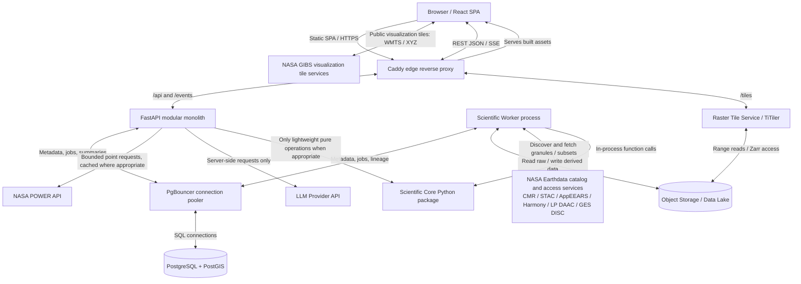
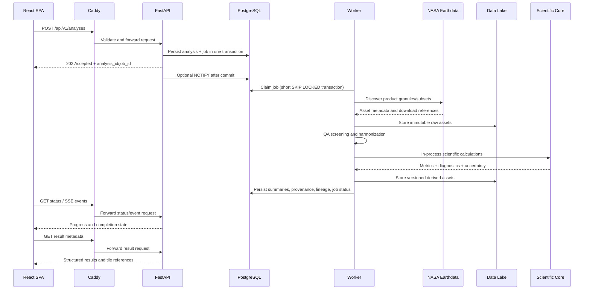

# PROJECT TERRA — System Architecture

> **Status:** Proposed architecture baseline  
> **Version:** 1.0  
> **Last updated:** 2026-11-14  
> **Scope:** Target architecture, component responsibilities, data flows, integration boundaries, and implementation constraints.

This document is the architectural reference for PROJECT TERRA. It describes the intended system design; it does **not** claim that every component is already implemented or deployed. Implementation status must be verified in the repository.

---

## 1. Product and System Purpose

PROJECT TERRA (Ecosystem Response & Resilience Intelligence) is an open-source environmental analysis platform for investigating how ecosystems respond to environmental stress, change over time, and recover after disturbances.

The platform combines Earth observation data, climate and hydrological variables, geospatial processing, statistical analysis, and explainable ecosystem assessments.

The primary analytical workflow is:

1. Select one or more geographic regions / Areas of Interest (AOIs).
2. Select an observation period, environmental event, and available data products.
3. Discover and retrieve source observations.
4. Apply quality screening and spatial-temporal harmonization.
5. Calculate environmental indicators and statistical metrics.
6. Assess resistance, recovery, stability, and sensitivity where the available data supports them.
7. Present results with provenance, coverage, quality information, and uncertainty.

TERRA must not imply causation from correlation. The experimental TERRA Resilience Index (TRI), if implemented, must be identified as an experimental, versioned model until independently validated.

## 2. Architectural Principles

1. **Modular monolith first.** Keep the backend in one logically modular codebase. API and Worker may run as separate processes, but share packages and domain logic.
2. **Explicit boundaries.** API, application workflows, domain rules, infrastructure adapters, and scientific calculations have separate responsibilities.
3. **Scientific Core is pure.** Scientific calculations must not depend on FastAPI, SQLAlchemy, HTTP clients, object storage, or UI code.
4. **Asynchronous heavy work.** Large satellite downloads, raster processing, and long-running analyses execute in Worker processes, not inside normal HTTP request handlers.
5. **Object storage for large data.** Raster and multidimensional source/derived datasets belong in the Data Lake, not in PostgreSQL rows.
6. **PostgreSQL for operational state.** Store metadata, geometries, jobs, provenance records, and compact analytical summaries in PostgreSQL/PostGIS.
7. **Preserve source resolution and quality.** Resampling does not create information. Preserve original product identifiers, units, QA flags, grids, and temporal semantics.
8. **Reproducibility.** Every analytical result must be traceable to source data, product versions, processing parameters, code/model version, and execution time.
9. **Progressive infrastructure.** Add independently deployed services only when a concrete operational requirement justifies them.
10. **No invisible architecture changes.** Agents must not silently replace a component or bypass a boundary described here.

## 3. High-Level System Context



The diagram is a logical view. It does not imply that every arrow is a separate network service. In particular, calls to the Scientific Core are ordinary in-process Python calls inside the API or Worker process that imports the package.

## 4. Runtime Components

### 4.1 Frontend SPA

**Technology baseline:** React 19, TypeScript, Vite, MapLibre GL JS 5, deck.gl, Zustand, TanStack Query, and Apache ECharts.

Responsibilities:

- Render the application shell, pages, map workspace, analytical charts, and assessment views.
- Manage user interaction and shareable analysis configuration.
- Request application data through the backend API.
- Display job progress through Server-Sent Events (SSE) or status polling.
- Render map tiles and analytical overlays using the mapping stack.

State ownership:

- **TanStack Query:** remote/server state, request caching, mutations, job status, and invalidation.
- **Zustand:** shared client-side UI state, such as visible layers, panel state, and transient selections.
- **React state:** component-local state.
- **URL query parameters:** durable/shareable filters and analysis configuration where appropriate.

Do not duplicate API response data in Zustand. Do not put scientific calculations in React components. Do not place Earthdata credentials or LLM provider keys in browser code.

#### Frontend architecture

Follow the repository's FSD-lite rules:

- `app` — application bootstrap, providers, routing, global styles.
- `pages` — route-level compositions.
- `widgets` — substantial UI blocks such as map workspace and analysis panels.
- `features` — user actions and workflows.
- `entities` — domain-facing frontend models and UI representations.
- `shared` — reusable UI primitives, API client, utilities, configuration.

The frontend communicates with TERRA application endpoints through Caddy. Public NASA GIBS tile requests may be made directly by the browser when the selected service allows it.

### 4.2 NASA GIBS — Visualization Source

NASA Global Imagery Browse Services (GIBS) provides pre-generated Earth observation visualizations through standards-based services such as WMTS, WMS, TWMS, and TMS/XYZ.

In TERRA, GIBS is primarily a **display source** for contextual imagery and browse layers. It can provide a fast visual context layer without routing every tile through the TERRA backend.

Important boundary:

- GIBS tiles are rendered visualizations, not the analytical source files for TERRA's scientific calculations.
- Do not derive scientific measurements, NDVI time series, or pixel statistics by sampling screenshot/tile colors.
- For scientific calculations, retrieve the appropriate underlying product or an authoritative subset from its data provider.
- Preserve layer identifier, time selection, projection/tile matrix, and attribution.
- Do not assume every GIBS layer supports every date or projection; inspect service capabilities and product availability.

### 4.3 Caddy — Edge Gateway and Reverse Proxy

Caddy is the public HTTP entry point and deployment edge component. It is a reverse proxy/static web server, not a business-aware API service.

Responsibilities:

- Terminate HTTPS and manage certificates.
- Serve the compiled SPA and apply SPA fallback routing.
- Route `/api/*` to FastAPI.
- Route `/events/*` (or the chosen SSE route) to FastAPI while preserving streaming behavior.
- Route `/tiles/*` to the raster tile service if that service is deployed behind the same origin.
- Apply suitable static asset cache headers and HTTP compression where supported.
- Set or forward required proxy headers and request IDs.

Security and operational rules:

- Do not cache authenticated or user-specific API responses as public static content.
- Configure request/body/read timeouts intentionally; long scientific jobs must not be held open as HTTP requests.
- SSE proxying must not buffer the stream and must use appropriate idle/read timeout settings.
- Rate limiting is not assumed to be a built-in Caddy core feature. If required, use a verified Caddy module, an upstream edge service, or application-level rate limiting.
- Keep the Caddy configuration in version control and validate it before deployment.

### 4.4 FastAPI Backend — Modular Monolith

**Technology baseline:** Python, FastAPI, Granian, Pydantic, SQLAlchemy, PostgreSQL/PostGIS, and `uv` for dependency management.

The Backend exposes the product's application API and coordinates workflows. It is not responsible for running long satellite-processing jobs inside request handlers.

Responsibilities:

- Versioned HTTP API and input validation.
- Application use-case orchestration.
- Authentication/authorization when introduced.
- Region/AOI and analysis configuration management.
- Job creation, status retrieval, and cancellation requests.
- Metadata, lineage, and summary persistence through repositories.
- Calling external providers through infrastructure clients when a bounded synchronous request is appropriate.
- Calling LLM providers server-side through a dedicated adapter.

#### Mandatory backend layering

```text
HTTP Router
    -> Application Use Case / Service
        -> Domain Rules and Repository Contracts
            <- Infrastructure Repository Implementations
```

- **API layer:** APIRouter modules, request/response schemas, dependency wiring, HTTP error mapping. Keep route handlers thin.
- **Application layer:** use cases and orchestration. Coordinates repositories, provider ports, job submission, and transactions.
- **Domain layer:** domain entities, value objects, invariants, and repository interfaces (`Protocol` or abstract contracts).
- **Infrastructure layer:** SQLAlchemy mappings/repositories, external API clients, object storage adapters, queue adapter, and provider implementations.

The Domain Layer must not import FastAPI, SQLAlchemy, HTTP clients, or object-storage SDKs.

#### Repository Pattern

Repository contracts belong to the domain or an explicitly defined application port. Concrete persistence implementations belong to infrastructure.

Rules:

- Each domain module owns repositories for its own aggregates/data needs.
- Application use cases depend on repository interfaces, never on concrete SQLAlchemy repositories.
- Do not access the database directly from routers.
- Do not expose ORM models outside infrastructure mappings/adapters.
- Use explicit domain-oriented repository methods; avoid a universal generic CRUD repository.
- Use a Unit of Work or equivalent explicit transaction boundary when multiple repositories must commit atomically.
- Analytical SQL/read models may use dedicated query services instead of forcing every query through an aggregate repository.

#### Suggested backend modules

```text
backend/core/terra/
  main.py
  api/
    dependencies.py
    v1/router.py
  modules/
    regions/
      api/{router.py, schemas.py}
      application/{services.py, use_cases/}
      domain/{entities.py, repositories.py}
      infrastructure/{models.py, repositories/}
    data_sources/
      api/
      application/
      domain/
      infrastructure/
        modis/
        gpm/
        smap/
        power/
    analyses/
    jobs/
    assessments/
    reports/
    ai_analyst/
  infrastructure/
    database/
    object_storage/
    queue/
    observability/
```

The structure is a baseline, not a reason to create empty folders for unimplemented features. Add a module when there is real functionality to place in it.

### 4.5 Worker — Separate Runtime, Shared Codebase

The Worker is a separate process/runtime for asynchronous ingestion, raster processing, and long-running analysis. It is not a separate microservice boundary by default.

Responsibilities:

- Claim queued jobs.
- Discover available source granules and subsets.
- Download source data asynchronously where supported.
- Store immutable raw source files in the Data Lake.
- Validate data, metadata, QA flags, checksums, and coverage.
- Produce harmonized intermediate datasets.
- Invoke Scientific Core algorithms.
- Write derived datasets and compact result summaries.
- Persist job state, provenance, and lineage.
- Emit progress updates.

Use async I/O for network and storage operations. CPU-heavy raster and statistical calculations must not block the event loop; use suitable process-based execution or dedicated compute workers when required.

The API and Worker share application/domain/scientific packages, but they do not share process memory. “In-memory call” means a normal function call inside the current process, not an RPC or shared-memory channel between API and Worker.

### 4.6 Scientific Core — Pure Python Package

Scientific Core contains deterministic algorithms and domain calculations. It is a library imported by the Worker and, where appropriate, by the Backend for inexpensive operations.

Example conceptual contract:

```python
result = calculate(
    data=data_array_or_dataset,
    parameters=analysis_parameters,
)  # -> ScientificResult
```

Input and output contracts should be typed and documented. A result should carry more than a scalar: include metric values, units, time/spatial support, valid-observation coverage, method/version identifiers, diagnostics, and uncertainty information when available.

Rules:

- No HTTP, FastAPI, database, queue, or cloud-storage dependency.
- No hidden network or filesystem access.
- No mutation of input arrays unless explicitly documented.
- Explicit nodata/missing-value behavior and units.
- Deterministic calculations where practical.
- Tests for normal inputs, edge cases, missing data, numerical stability, and invariants.
- Statistical assumptions and limitations documented beside each method.

Candidate methods include seasonal baselines/anomalies, robust standardization, Mann–Kendall (including seasonal/autocorrelation-aware variants where appropriate), Sen's slope, resistance and recovery metrics, and uncertainty/coverage diagnostics. The exact method configuration must be versioned.

TRI is an experimental aggregation model. Its components, normalization, weights, applicability, and validation evidence must be explicit. Do not invent coefficients or present a provisional score as a universally validated ecological standard.

### 4.7 PostgreSQL + PostGIS — Operational and Spatial Database

PostgreSQL is the system of record for structured operational state. PostGIS adds geospatial types and spatial operations.

Expected data categories:

- Regions and AOI geometries.
- Analysis requests and configurations.
- Job state, attempts, lease timestamps, and progress metadata.
- Data product/catalog metadata and source references.
- Processing lineage and provenance records.
- Compact statistical summaries and assessment metadata.
- Users/permissions if authentication is implemented.

Do not store large satellite rasters, large multidimensional arrays, or bulky intermediate files in ordinary PostgreSQL columns. Store them in the Data Lake and reference them from metadata records.

Use appropriate SRIDs and spatial indexes. Geographic coordinates in EPSG:4326 are angular units; use suitable projected coordinates or geography-aware operations for metric area/distance calculations.

### 4.8 PgBouncer — Database Connection Pooler

PgBouncer pools PostgreSQL client connections. It is not a database, queue, cache, or persistence layer.

Backend and Worker may connect through PgBouncer to control database connection counts. Pool mode must be selected deliberately and tested with the actual SQLAlchemy/driver configuration.

**Important `LISTEN` constraint:** PgBouncer transaction pooling does not support session-level `LISTEN`. If PostgreSQL notifications are used to wake workers, the listener must connect directly to PostgreSQL or through a compatible session-pooled connection. Do not run a long-lived `LISTEN` connection through transaction pooling.

The job table remains the durable source of truth; notification delivery is only a wake-up optimization. Workers must still be able to discover pending jobs by polling/reclaiming them.

PgBouncer may be optional in local development and early deployment until multiple processes or connection pressure justify it. If included, document the selected pool mode and connection limits.

### 4.9 Job Queue — PostgreSQL-backed Queue Baseline

The diagram uses PostgreSQL `LISTEN/NOTIFY` together with `FOR UPDATE SKIP LOCKED`. This can support a modest initial job queue without introducing a separate broker.

Conceptual flow:

1. API inserts a durable job row in the same transaction as the analysis request.
2. The transaction commits; an optional `NOTIFY` signals that work may be available.
3. Worker wakes up or polls the jobs table.
4. Worker claims a pending job using a short transaction and `FOR UPDATE SKIP LOCKED`.
5. Worker records owner/lease/attempt and commits the claim before executing the work.
6. Worker periodically updates heartbeat/progress and eventually marks the job succeeded or failed.
7. Expired leases can be reclaimed according to an explicit retry policy.

Required properties:

- Durable job records; notifications are not the queue itself.
- Atomic claim operation to prevent two workers claiming the same job.
- Idempotent job handlers or idempotency keys for retry safety.
- Bounded retries with backoff and a terminal failed state.
- Lease/heartbeat or equivalent recovery mechanism for crashed workers.
- Explicit cancellation semantics.
- Structured error codes and sanitized diagnostics.

`SKIP LOCKED` is appropriate for queue-like competing consumers, not as a general-purpose consistency strategy. Keep claim transactions short; never hold row locks while downloading or processing a dataset.

If job volume, scheduling needs, throughput, or operational requirements outgrow this approach, evaluate a dedicated broker. Do not add RabbitMQ/Redis/Kafka preemptively.

### 4.10 Data Lake — Object Storage

The Data Lake stores large source and derived geospatial datasets. It should be backed by S3-compatible or equivalent object storage; the exact provider is a deployment decision.

Logical data zones:

- **Raw:** immutable provider-native downloads/subsets, source metadata, original QA layers, and checksums.
- **Intermediate:** normalized grids, quality-screened arrays, and spatial-temporal harmonization outputs.
- **Curated/Derived:** analysis-ready products and versioned outputs.

Preferred formats by use case:

- **COG:** tiled raster products for efficient partial reads and map serving.
- **Zarr:** chunked multidimensional arrays/time series for analysis and cloud access.
- **Parquet / GeoParquet:** tabular observations, zonal summaries, and feature data.
- Provider-native HDF5/NetCDF/GeoTIFF may be retained in Raw when appropriate.

Every object must be traceable to a source/product/granule and processing run. Preserve checksums, acquisition period, CRS, affine/grid metadata, units, nodata, QA policy, and software/method version in metadata or a linked manifest.

Recommended logical key pattern (adapt to the chosen object store):

```text
raw/{provider}/{mission_or_product}/{version}/{year}/{month}/{granule}/...
intermediate/{dataset_id}/{processing_version}/...
derived/{analysis_id}/{run_id}/{product}/...
```

Do not overwrite immutable raw objects. Derived outputs should be versioned or content-addressed.

### 4.11 Raster Tile Service — TiTiler

TiTiler is a specialized dynamic tile service built on FastAPI and geospatial raster libraries. It can expose Cloud Optimized GeoTIFFs as map tiles and has extensions/packages for STAC and multidimensional data through Xarray, including Zarr workflows.

Responsibilities:

- Serve raster tiles/previews for stored COG assets.
- Provide metadata and tile endpoints for selected derived datasets.
- Optionally serve supported Zarr/Xarray datasets through the relevant TiTiler application/extensions.
- Read only the required windows/chunks from object storage rather than transferring entire rasters to the browser.

The Backend should authorize a dataset request and return a controlled tile URL or proxy path. Do not let the browser submit arbitrary object-store URLs to an unrestricted public TiTiler endpoint. Validate asset identifiers and apply access controls to private datasets.

TiTiler may run as a separate process/service when raster serving needs independent scaling. It is not required to be a separate microservice in the initial local prototype.

### 4.12 NASA Earthdata Catalog and Access Services

The Worker uses NASA Earthdata catalog and access systems to discover and retrieve scientific source products. The diagram lists CMR/STAC, Harmony, AppEEARS, GES DISC, and LP DAAC; these are access/catalog/provider components, not one interchangeable API.

Intended roles:

- **CMR:** discover collections and granules; filter by temporal/spatial extent and product identifiers.
- **STAC:** catalog/search interface where supported by the selected provider/product.
- **AppEEARS:** request spatial/temporal subsets and selected layers for supported products.
- **Harmony:** subset/transform supported Earthdata datasets and access cloud-hosted assets.
- **LP DAAC / GES DISC:** provider data centers and product distribution systems for relevant datasets.

Implement provider-specific clients behind common internal interfaces. Do not assume every provider supports the same query parameters, authentication flow, output format, or latency.

Credentials must be managed server-side. Use NASA Earthdata Login credentials/tokens through a secure secret mechanism. Never expose tokens in frontend code, logs, error messages, or public URLs. Respect provider rate limits and retries.

### 4.13 NASA POWER

NASA POWER provides convenient point and regional time-series HTTP APIs for selected meteorological/solar parameters. It is distinct from direct satellite product download workflows; many meteorological data products are based on model/reanalysis inputs.

The diagram proposes a synchronous point-series request from Backend to POWER. This is permitted only for small, bounded requests with:

- strict connect/read timeouts;
- bounded retries;
- parameter/date/range validation;
- cache policy and cache key;
- provider attribution and source metadata;
- graceful fallback/error state.

A fixed response-time assumption (for example, 400–800 ms) is not an architectural guarantee and must be measured. Long-range, regional, or repeated requests should be cached and/or moved to Worker ingestion rather than blocking user-facing requests.

Where GPM IMERG is selected as the primary precipitation data source, POWER precipitation should be treated as a secondary/comparison source rather than silently double-counted as an independent observation.

### 4.14 LLM Provider API — Optional AI Analyst

LLM access is server-side only and must be isolated behind an application service/provider adapter.

The AI Analyst may:

- Explain already-computed results in plain language.
- Summarize source provenance and method limitations.
- Help users navigate available indicators and reports.
- Draft a report grounded in stored analysis results.

The AI Analyst must not:

- Invent measurements, confidence intervals, p-values, or coefficients.
- Replace Scientific Core calculations.
- Claim causation from correlations.
- Hide missing data, QA exclusions, or uncertainty.
- Access arbitrary internal resources based only on user-provided instructions.

Prompts should receive validated result objects, provenance, and explicit limitations. Outputs should be checked against structured result data before being presented as scientific findings.

## 5. Key Data Flows

### 5.1 Homepage Map Rendering

1. Browser loads the React SPA from Caddy.
2. MapLibre initializes the base map and map controls.
3. Public NASA GIBS WMTS/XYZ layers may be requested directly by the browser for visualization.
4. TERRA analytical overlays are requested from the controlled tile service when derived COG/Zarr products exist.
5. No scientific calculation is performed from rendered tile pixels.

### 5.2 Create and Execute an Analysis



Long-running requests return `202 Accepted`; the browser must not hold a single HTTP request open while the entire ingestion/analysis runs.

### 5.3 Raster Visualization

1. Worker writes a COG or supported Zarr output to object storage.
2. Metadata and asset reference are persisted in PostgreSQL.
3. Backend checks the user's access and resolves a safe asset identifier.
4. Frontend requests a tile URL from the TERRA tile service.
5. TiTiler reads only the needed raster windows/chunks and returns map tiles.
6. MapLibre renders conventional raster sources; deck.gl is used for complex interactive overlays and GPU-oriented vector/aggregate visualizations.

### 5.4 Point-Series Request

Small NASA POWER point requests may be served synchronously through Backend with strict timeouts and cache. Larger requests or repeated region series should be materialized by Worker and stored as derived time-series data.

### 5.5 AI-assisted Explanation

1. Frontend requests an explanation for an existing analysis/result identifier.
2. Backend retrieves validated result data and provenance.
3. Backend sends only the necessary context to the selected LLM provider.
4. Backend validates/sanitizes the response and returns an explanation clearly distinguished from computed metrics.

## 6. Geospatial and Temporal Data Harmonization

The four initial data sources have different spatial grids, time steps, product semantics, and quality flags. They must not be merged by array index or by simply resizing rasters to the same pixel dimensions.

### 6.1 Spatial rules

- Preserve each source product's original grid, CRS, resolution, and nodata/QA information in Raw.
- Transform AOI geometries to the product grid/CRS for extraction.
- Prefer zonal statistics on each dataset's native grid for region-level comparisons.
- When pixel-level multi-source comparison is needed, define an explicit target grid and record the resampling method for each variable.
- Never describe an upsampled coarse source as having finer observational resolution.
- Consider cell-area weighting and partial pixel intersections for region summaries.
- Do not mix degree-based EPSG:4326 measurements with metric area/distance calculations without appropriate transformation or geography-aware methods.

### 6.2 Temporal rules

- Preserve native acquisition/composite intervals and timestamps.
- Define a common reporting cadence (for example monthly) per analysis, not globally without regard to source semantics.
- Aggregate according to variable meaning: precipitation depth is accumulated; temperature and soil moisture generally use suitable means/medians; vegetation composites require quality-aware temporal aggregation.
- For IMERG precipitation rates, convert interval rates to accumulated depth before summing.
- Record observation count, valid coverage, QA exclusions, and aggregation policy for each output period.
- Account for seasonal cycles when deriving baselines and anomalies.

### 6.3 Source-specific semantics

- MODIS MOD13Q1 NDVI/EVI are 16-day composites; use product scale factors and QA flags.
- MODIS LST product values require their product-specific scale factor and Kelvin-to-Celsius conversion where relevant.
- GPM IMERG provides precipitation estimates at its native temporal/spatial resolution and run type; record Early/Late/Final and version.
- SMAP SPL3SMP_E is a surface soil-moisture product; do not present it as a direct measurement of the full root-zone moisture profile.
- NASA POWER meteorological parameters are not interchangeable with MODIS LST or direct precipitation sensor measurements; preserve parameter source and units.

## 7. API and Integration Contracts

All business API routes are versioned under `/api/v1`. Health/readiness endpoints are operational endpoints and should be kept separate from business resources.

Illustrative endpoints (final schema and naming must be defined during implementation):

```text
GET    /health
GET    /ready

GET    /api/v1/regions
POST   /api/v1/regions
GET    /api/v1/regions/{region_id}

POST   /api/v1/analyses
GET    /api/v1/analyses/{analysis_id}
GET    /api/v1/analyses/{analysis_id}/results
GET    /api/v1/jobs/{job_id}
POST   /api/v1/jobs/{job_id}/cancel

GET    /api/v1/data-sources
GET    /api/v1/data-products
GET    /api/v1/assessments/{assessment_id}
GET    /api/v1/reports/{report_id}
GET    /api/v1/analyses/{analysis_id}/events  # SSE, if exposed this way
```

Rules:

- Validate AOI, date range, product identifiers, allowed parameters, and estimated workload before enqueueing.
- Use explicit Pydantic request/response schemas.
- Return `202 Accepted` for work that is queued for asynchronous execution.
- Use consistent error response structure and stable error codes.
- Do not return internal filesystem paths, provider credentials, raw stack traces, or unrestricted object-store URLs.
- API responses should expose asset identifiers, provenance, coverage, and authorized tile URLs as appropriate.

## 8. Reliability, Security, and Observability

### Reliability

- External provider clients need bounded timeouts, retry policy, and backoff.
- Retries must not duplicate data products or corrupt job state.
- Raw source objects should be immutable and checksummed.
- Worker jobs must be recoverable after process failure.
- Record job status transitions and failure reasons.
- Use cache only where the cache key includes all relevant query dimensions, product version, time range, and processing configuration.

### Security

- Keep Earthdata credentials, database credentials, object-store secrets, and LLM API keys on the server.
- Use environment variables/secret management; commit only `.env.example` placeholders.
- Validate user-controlled AOIs, provider URLs, object identifiers, and query parameters.
- Prevent arbitrary URL fetching through the tile service (SSRF protection and asset allow-listing/resolution).
- Apply access control before returning private analysis assets.
- Do not expose sensitive configuration in logs.

### Observability

At minimum, log structured fields for:

- request ID / trace ID;
- analysis ID and job ID;
- module and provider;
- product ID/version and granule ID;
- processing stage;
- duration, retries, status, and error code.

Track operational metrics for queue depth, job duration, provider error rates, cache hit rate, data coverage, and worker failures. Logs must not contain secrets or full sensitive payloads.

## 9. Deployment Topology

Logical production topology:

```text
Internet
   |
   v
Caddy (TLS, SPA, reverse proxy)
   |-----------------------> NASA GIBS (browser-direct public tiles)
   |
   +---- /api, /events ----> FastAPI + Granian
   |                           |
   |                           +----> PgBouncer ----> PostgreSQL/PostGIS
   |                           +----> NASA POWER (bounded/cached requests)
   |                           +----> LLM provider (server-side)
   |
   +---- /tiles ----------> TiTiler / raster tile service
                               |
                               +----> Data Lake / object storage

Worker process --------------------> PostgreSQL/PostGIS via configured DB pool
   |                                 Data Lake / object storage
   +----> NASA Earthdata discovery and download services
   +----> Scientific Core (in-process)
```

The initial deployment does not require Kubernetes or a microservices platform. API and Worker can be separate processes launched from the same backend codebase. PgBouncer and TiTiler can be introduced as independently deployed components when justified by connection volume or raster-serving requirements.

## 10. Proposed Repository Layout

```text
TERRA/
├── AGENTS.md
├── README.md
├── docs/
│   └── architecture/
│       ├── SYSTEM_ARCHITECTURE.md
│       └── decisions/                 # ADRs added as decisions are approved
├── frontend/
│   ├── DESIGN.md
│   └── src/
│       ├── app/
│       ├── pages/
│       ├── widgets/
│       ├── features/
│       ├── entities/
│       └── shared/
└── backend/
    └── core/
        └── terra/
            ├── api/
            ├── modules/
            ├── scientific_core/        # or separately packaged Python library
            └── infrastructure/
```

This is a target organization, not an instruction to create every directory before the corresponding code exists.

## 11. Architectural Decisions and Constraints

| Area | Baseline decision | Constraint / revisit trigger |
|---|---|---|
| Backend topology | FastAPI modular monolith | Split a module only for a demonstrated independent deployment/scaling need. |
| API runtime | Granian serving FastAPI | Keep application code ASGI-server agnostic. |
| Worker | Separate process sharing backend packages | Do not duplicate use cases or domain rules. |
| Queue | PostgreSQL job table + `SKIP LOCKED`; optional `NOTIFY` wake-up | Revisit if throughput, scheduling, or operational needs exceed this pattern. |
| Connection pooling | PgBouncer where useful | `LISTEN` must not run through transaction pooling. |
| Database | PostgreSQL + PostGIS | Large arrays/rasters stay in object storage. |
| Data Lake | S3-compatible object storage | Provider remains deployment-specific. |
| Raster serving | TiTiler for COG and supported Xarray/Zarr paths | Validate exact extensions, formats, auth, and workload before deployment. |
| Base map | `d3-geo` Equal Earth + MapLibre GL JS v5 (Globe & Mercator) | Equal Earth renders natively via `d3-geo`; GIBS layers remain browse/visualization only. |
| Analytical overlays | `@deck.gl/maplibre` `MapLibreOverlay` | Attached in 2D Mercator mode only; MapLibre-native vector/GeoJSON sources used in Globe mode. |
| Climate point data | NASA POWER API | No fixed latency guarantee; cache and bound requests. |
| AI assistance | Backend-mediated LLM adapter | LLM cannot calculate or invent scientific metrics. |
| Edge | Caddy | Rate limiting requires a verified module or application/edge solution. |

### Map Explorer Frontend Architecture (`/explore`) — Implemented vs. Planned

To avoid tight coupling between React components and geospatial rendering engines, `/explore` separates projection engines, registries, state management, and future data providers across FSD-lite layers:

1. **Projection-Independent Rendering Abstraction (`entities/map`)**:
   - `MapRenderer` defines a uniform lifecycle (`mount`, `update`, `setViewport`, `zoomIn`, `zoomOut`, `resetView`, `flyTo`, `destroy`) and capability flags (`supportsDeckGl`, `supports3dGlobe`, `supportsRasterTiles`, `supportsAntimeridianClipping`).
   - `EqualEarthRenderer` (`d3-geo` `geoEqualEarth()`) is the default global projection using Natural Earth `1:110m` WGS 84 GeoJSON boundaries, coastlines, graticules, coordinate inversion (`invert`), antimeridian handling, and optional client-side canvas reprojection of NASA GIBS `EPSG:4326` `500m` static composites.
   - `MapLibreRenderer` (`maplibre-gl` v5) drives `Globe` (3D spherical projection with atmospheric sky styling and native MapLibre GeoJSON overlays) and `Mercator` (`EPSG:3857` visualization-only navigation with validated `@deck.gl/maplibre` `MapLibreOverlay` overlays).
   - `MapProjectionController` switches cleanly between `d3-geo` and `MapLibre` engines on projection change while preserving center/zoom camera state and cleaning up DOM listeners and WebGL contexts on unmount.
2. **Centralized Basemap & Layer Registries (`shared/config/geospatial.ts`, `entities/layer`)**:
   - `BASEMAP_PROVIDER_REGISTRY` isolates public provider URLs (`VITE_NASA_GIBS_BASE_URL`, default `https://gibs.earthdata.nasa.gov`), WMTS `GoogleMapsCompatible_Level8`/`Level9` (`epsg3857`) and `500m` (`epsg4326`) tile matrices, date formatting rules for temporal VIIRS reflectance (`VIIRS_SNPP_CorrectedReflectance_TrueColor`), attribution strings, and projection compatibility flags.
   - `ENVIRONMENTAL_LAYER_CATALOG` catalogs 16 Vegetation (`MOD13Q1.061`), Temperature (`MOD11A2.061`), Water (`GPM IMERG V07`, `SMAP SPL3SMP_E`), and Derived resilience/trend layers with explicit `availabilityStatus` (`connected`, `preview`, `planned`, `unavailable`), units, native spatial resolutions, QA policies, legend stops, and prepared `MapTileSource` descriptors (`cog`, `tilejson`, `zarr`, `mvt`, `geojson`, `wmts`).
3. **Frontend Data Provider Contract & State (`shared/types/geospatial.ts`, `shared/api`, `features/map-explorer`)**:
   - `MapDataProvider` defines replaceable async operations (`getLayers`, `getLayerMetadata`, `getTemporalCoverage`, `inspectPoint`, `getAreaObservation`) consumed via TanStack Query hooks.
   - `MockMapDataProvider` currently supplies catalog metadata, simulated catalog coverage counts, and explicit `unavailable` point/area observation responses; all synthetic visual overlays are isolated behind `syntheticPreviewEnabled` and labeled `SYNTHETIC / DEMONSTRATION DATA`.
   - `useExploreStore` (Zustand) manages active projection, basemap, layer stretch/opacity, temporal playback state, WGS 84 (`EPSG:4326`) AOI drafting/export, and side-by-side comparison panes, synchronized with URL query parameters via `useExploreUrlSync`.
4. **Implemented vs. Planned Capabilities Boundary**:
   - **Implemented (Frontend Workspace)**: `/explore` full-screen GIS shell, Homepage entry button (`Open Map Explorer`), three projection engines (`Equal Earth`, `Globe`, `Mercator`), verified public NASA GIBS Blue Marble / Shaded Relief / VIIRS True Color basemaps, 16-layer metadata catalog & legends, Point Inspector metadata view, WGS 84 polygon/rectangle drawing + `EPSG:4326` GeoJSON export, temporal playback controls, and side-by-side camera/layer/period comparison.
   - **Planned (Requires Backend API & Scientific Core)**: Authenticated NASA Earthdata/POWER/STAC discovery, TiTiler dynamic COG/Zarr raster tile streaming, real pixel/time-series point extraction at native cell footprints, PostGIS/Worker zonal statistics, server-side Mann–Kendall / Sen's Slope / TRI computations, and pixel-wise comparison swipe/difference maps.

### Explicit diagram clarifications

The conceptual architecture diagram should be interpreted with the following clarifications:

1. **Scientific Core arrows are in-process calls.** API and Worker do not share memory. Each process imports the relevant package and calls it locally.
2. **The job queue is durable PostgreSQL state.** `LISTEN/NOTIFY` is only a signal to wake workers, not the job payload store or delivery guarantee.
3. **PgBouncer is a connection pooler.** It sits between clients and PostgreSQL; it is not the owner of job state. Use a direct/session-pooled connection for `LISTEN` if needed.
4. **GIBS is a browse/visualization service.** Underlying scientific products must be retrieved independently for analysis.
5. **TiTiler is a raster access layer.** The Backend should authorize and resolve assets; the tile service should perform windowed raster reads and tile generation.
6. **POWER latency is variable.** Any `400–800 ms` value in an early diagram is a measurement target/hypothesis, not an SLA or correctness assumption.
7. **Caddy rate limiting is not assumed to exist in the core binary.** Verify the selected module or enforce limits elsewhere.
8. **The Data Lake is object storage, not a database.** PostgreSQL stores searchable metadata and references to objects.

## 12. Rules for AI Coding Agents

Before making a non-trivial architectural or cross-module change, the agent must:

1. Read the root `AGENTS.md`.
2. Read this document (`docs/architecture/SYSTEM_ARCHITECTURE.md`).
3. Inspect the relevant existing modules and tests.
4. Identify which component/layer owns the requested behavior.
5. Reuse existing contracts and adapters before introducing new ones.
6. State any divergence from this architecture before implementing it.

Agents must not:

- add a new database, broker, API gateway, map engine, or microservice without a documented reason;
- perform database access in API route handlers;
- bypass repository interfaces from application services;
- put heavy scientific processing inside FastAPI request handlers;
- implement scientific algorithms in frontend code;
- use GIBS rendered tiles as scientific input data;
- expose Earthdata or LLM credentials in the browser;
- store large rasters in PostgreSQL;
- silently invent scientific formulas, weights, or results;
- repeat expensive Figma/repository discovery when the required information is already documented.

If implementation needs to diverge, explain why and propose an Architecture Decision Record (ADR). Update this document only after the decision is accepted or the implementation is deliberately approved as the new baseline.

## 13. Open Decisions

The following must be finalized when implementation reaches the relevant stage:

- Concrete object-storage provider and bucket lifecycle policy.
- Whether PgBouncer is needed in the first deployment and which pool mode is selected.
- Exact PostgreSQL job-queue schema, polling interval, notification listener topology, retry limits, and lease duration.
- Whether TiTiler runs as a separate process and which COG/Zarr extensions are enabled.
- Exact GIBS layers, date domains, projections, and attribution presentation.
- NASA provider access method per product/version and data licensing/attribution requirements.
- Analysis cadence and spatial harmonization policy for each variable/product combination.
- Authentication and authorization model.
- Observability stack and deployment environment.
- TRI operational definition, normalization, weighting, uncertainty, and validation strategy.

Do not treat an open decision as permission to make an arbitrary global choice. Document the decision and rationale when resolved.

## 14. References

- [NASA GIBS API documentation](https://nasa-gibs.github.io/gibs-api-docs/) — visualization tile services and access patterns.
- [TiTiler documentation](https://developmentseed.org/titiler/) — dynamic COG, STAC, and multidimensional raster tiling.
- [PostgreSQL `SELECT` / `SKIP LOCKED`](https://www.postgresql.org/docs/current/sql-select.html) — concurrent row claiming for queue-like tables.
- [PostgreSQL `NOTIFY`](https://www.postgresql.org/docs/current/sql-notify.html) — interprocess notification mechanism.
- [PgBouncer feature matrix](https://www.pgbouncer.org/features.html) — session/transaction pooling feature compatibility, including `LISTEN`.
- [Caddy reverse proxy documentation](https://caddyserver.com/docs/caddyfile/directives/reverse_proxy) — edge routing and upstream proxy configuration.

---

**Architecture principle:** TERRA is a modular scientific application with a clear separation between visualization, orchestration, data access, computation, persistence, and interpretation. Build each boundary deliberately and keep every analytical result reproducible and explainable.
